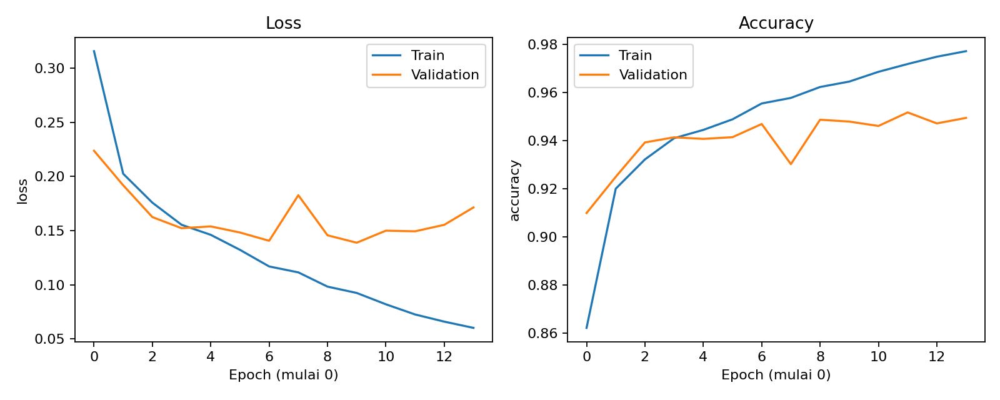
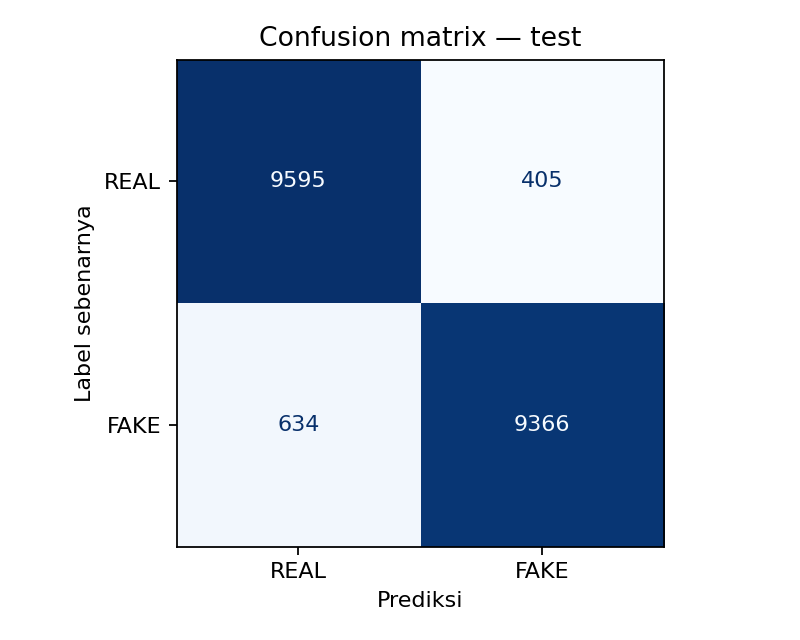
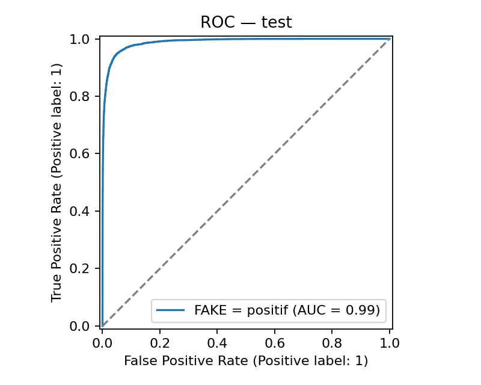

**“Klasifikasi Gambar Asli dan Gambar Sintetis AI Menggunakan Convolutional Neural Network pada Dataset CIFAKE.”**

Implementasi tugas individu mata kuliah Deep Learning. Model CNN dilatih dari awal untuk membedakan **REAL** (gambar asli) dan **FAKE** (gambar sintetis AI) pada CIFAKE. Masalah ini merupakan klasifikasi seluruh gambar menjadi dua kelas; model tidak menghasilkan kotak lokasi objek.

**Status eksperimen:** pelatihan dan evaluasi CIFAKE telah selesai di Google Colab pada 6 November 2026 dengan TensorFlow 2.21.0 dan GPU yang terdeteksi. Accuracy test **94,805%** pada 20.000 gambar; ROC-AUC **0,98860692**. Pelatihan berlangsung 14 epoch dan checkpoint terbaik menurut validation loss berasal dari epoch 10. Hasil ini berasal dari output notebook Colab yang dibagikan, bukan dari uji data buatan.

## Tujuan dan batas penelitian

Pertanyaan penelitian: seberapa baik CNN sederhana membedakan citra asli dan citra sintetis dalam dataset CIFAKE?

CNN mempelajari fitur spasial melalui konvolusi. Pada tugas ini, fitur dapat mencakup tekstur dan pola lokal yang berbeda antara dua sumber data. Keberadaan fitur tersebut tidak membuktikan bahwa model memahami proses pembuatan gambar.

Eksperimen mengukur kinerja dalam distribusi CIFAKE. REAL berasal dari CIFAR-10 dan FAKE dibuat dengan Stable Diffusion 1.4. Model mungkin mempelajari karakteristik dataset, kompresi, atau generator tertentu. Hasilnya tidak dapat langsung digeneralisasi ke seluruh gambar dari generator lain, gambar beresolusi tinggi, gambar yang diedit, atau gambar dari media sosial. Skor sigmoid belum dikalibrasi dan bukan bukti pasti keaslian suatu gambar.

## Dataset

Sumber utama: [repository penulis CIFAKE](https://github.com/jordan-bird/CIFAKE-Real-and-AI-Generated-Synthetic-Images) dan [halaman dataset Kaggle](https://www.kaggle.com/datasets/birdy654/cifake-real-and-ai-generated-synthetic-images).

| Bagian resmi | REAL | FAKE | Total |
|---|---:|---:|---:|
| Train | 50.000 | 50.000 | 100.000 |
| Test | 10.000 | 10.000 | 20.000 |
| Total | 60.000 | 60.000 | 120.000 |

Citra RGB berukuran 32×32 piksel. Label dibuat eksplisit: **REAL=0, FAKE=1**; skor keluaran model mengarah pada FAKE. Jangan mengandalkan urutan alfabet folder untuk menentukan label.

Validasi diambil secara terstratifikasi sebesar 20% dari bagian train resmi. Sebelum audit, rancangan pembagiannya adalah 80.000 train, 20.000 validation, dan 20.000 test. Jumlah aktual dapat berubah setelah gambar train yang identik disisihkan.

Audit menghitung SHA256 dari piksel RGB yang didekode. Gambar train yang identik dengan test disisihkan dari train; pengulangan piksel identik di train disatukan sebelum pemisahan train/validation. Test resmi dipertahankan seluruhnya, termasuk pengulangan internal yang jumlahnya dicatat. Label yang bertentangan dan gambar rusak menghentikan proses. Pemeriksaan ini belum mendeteksi gambar yang hanya mirip atau turunan hasil crop/kompresi.

Data mentah tidak disertakan dalam paket ini. Notebook mengunduh data dari Kaggle. Rujukan dan ketentuan penggunaan data tetap mengikuti sumber aslinya; penulis CIFAKE menyatakan lisensi MIT dan meminta sitasi CIFAKE serta CIFAR-10.

## Hasil tersimpan dan reproduksi

Notebook `CNN_Deteksi_Gambar_AI.ipynb` sudah memuat output pelatihan, evaluasi,
dan pembahasan. Buka notebook untuk membaca hasil tanpa perlu melatih ulang.
[Notebook sumber di Colab](https://colab.research.google.com/drive/1wz4pX37ydvBi5bJtEJ4QXYC7OzzLXtfy?usp=sharing)
menjadi sumber bukti eksekusinya.

Folder `results/cifake_20261106_152038_931353/` pada paket ini berisi metrik,
audit, grafik, dan log yang diekstrak dari output notebook. Riwayat epoch pada
`training_history_from_notebook.csv` mengikuti log empat desimal, bukan CSV history
asli. `provenance.json` mencatat sumber serta batas verifikasi.

**Bobot `best_model.keras`, konfigurasi run asli, manifest per gambar, dan
prediksi per gambar belum tersedia dalam paket lokal ini.** Ambil dari ZIP hasil
Colab `cifake_20261106_152038_931353.zip` yang unduhannya dipicu pada sel terakhir,
lalu tambahkan ke folder run yang sama. Jangan memakai bobot uji data buatan
sebagai pengganti model CIFAKE. Pembacaan notebook dan penilaian hasil tetap dapat
dilakukan dari output yang tersimpan; inferensi baru memerlukan bobot model asli.

Untuk mereproduksi eksperimen, buka notebook di Colab, gunakan runtime GPU bila
tersedia, dan jalankan sel dari atas ke bawah. Data diunduh lewat KaggleHub; jika
perlu, gunakan login resmi atau isi `LOCAL_DATA_DIR` dengan folder dataset sendiri.
Jangan menyimpan token dalam sel. Menjalankan ulang akan membuat run baru,
sehingga angka baru dapat berbeda dari hasil tersimpan. Versi library aktual
dicatat oleh kode pada setiap run.

## Menjalankan secara lokal

Gunakan Python 3.10–3.12 dan lingkungan virtual. Dari folder proyek:

```bash
python -m venv .venv
source .venv/bin/activate
# Windows: .venv\Scripts\activate
python -m pip install -r requirements.txt
python cnn_detector.py train --output-dir results/cifake_01
```

Untuk dataset yang sudah diunduh:

```bash
python cnn_detector.py train --data-dir data/cifake --epochs 20 --output-dir results/cifake_01
```

Struktur yang dibutuhkan:

```text
data/cifake/
├── train/
│   ├── REAL/
│   └── FAKE/
└── test/
    ├── REAL/
    └── FAKE/
```

Prediksi satu gambar setelah pelatihan:

```bash
python cnn_detector.py predict --model results/cifake_01/best_model.keras --image contoh.jpg
```

Input baru diubah menjadi RGB 32×32 dengan interpolasi bilinear. Perubahan ukuran ini membuang banyak detail; contoh dari luar CIFAKE perlu diperlakukan sebagai demonstrasi dan tidak digabungkan dengan evaluasi test resmi.

## Arsitektur dan pelatihan

| Lapisan | Bentuk keluaran |
|---|---|
| Input RGB | 32×32×3 |
| Rescaling 1/255 | 32×32×3 |
| Conv2D 32, kernel 3×3, ReLU, same | 32×32×32 |
| MaxPooling 2×2 | 16×16×32 |
| Conv2D 64, kernel 3×3, ReLU, same | 16×16×64 |
| MaxPooling 2×2 | 8×8×64 |
| Conv2D 128, kernel 3×3, ReLU, same | 8×8×128 |
| MaxPooling 2×2 | 4×4×128 |
| Flatten | 2.048 |
| Dense 128, ReLU | 128 |
| Dropout 0,5 | 128 |
| Dense 1, sigmoid | Skor FAKE |

Total parameter: **355.649**, seluruhnya dapat dilatih. Ini merupakan rancangan baseline proyek, bukan reproduksi persis arsitektur terbaik makalah CIFAKE.

Adam memakai learning rate 0,001, batch size 128, maksimum 20 epoch, dan loss binary cross-entropy. Early stopping memakai validation loss dengan patience 4. Checkpoint dipilih berdasarkan validation loss terendah. Threshold tetap 0,5 ditetapkan sebelum evaluasi test: skor ≥0,5 diklasifikasikan FAKE. Tidak ada augmentasi pada baseline agar pengaruh transformasi tambahan tidak tercampur pada percobaan pertama. Model tidak memakai bobot pralatih.

## Evaluasi dan berkas hasil

FAKE diperlakukan sebagai kelas positif. Precision FAKE mengukur proporsi prediksi FAKE yang benar. Recall FAKE mengukur bagian gambar FAKE yang berhasil ditemukan. F1 menyeimbangkan precision dan recall. ROC-AUC dihitung dari skor kontinu.

| Berkas | Fungsi |
|---|---|
| `best_model.keras` | Model dengan validation loss terbaik, termasuk normalisasi |
| `metrics.json` | Accuracy, precision/recall/F1 FAKE, ROC-AUC, majority baseline |
| `classification_report.txt` | Precision, recall, F1, dan support untuk kedua kelas |
| `confusion_matrix.png` | Baris: label sebenarnya; kolom: prediksi; urutan REAL, FAKE |
| `training_curves.png`, `roc_curve.png` | Grafik pelatihan dan evaluasi |
| `test_predictions.csv` | Prediksi setiap gambar test dalam urutan tetap |
| `error_examples.png` | Maksimum 8 kesalahan pertama; hanya dibuat bila ada kesalahan |
| `training_history.csv` | Riwayat metrik per epoch |
| `data_audit.json`, `*_manifest.csv` | Hitungan audit serta pembagian data yang digunakan |
| `run_config.json`, `model_summary.txt` | Konfigurasi, versi library, dan arsitektur |

Baseline mayoritas ditentukan hanya dari label train lalu dievaluasi pada test. Untuk data seimbang, accuracy sekitar 50% merupakan pembanding dasar, bukan target hasil CNN. Test dipakai setelah pemilihan model selesai. Apabila mencoba arsitektur lain, pilih berdasarkan validation dan hindari menyesuaikan model berulang kali terhadap test.

## Pembahasan hasil eksperimen

Eksperimen dilaksanakan pada 6 November 2026 menggunakan TensorFlow 2.21.0 dengan
GPU yang terdeteksi pada runtime Colab. CNN dilatih dari awal pada citra RGB 32×32,
menggunakan Adam dengan learning rate 0,001, batch size 128, dan seed 42. FAKE
ditetapkan sebagai kelas positif dan threshold klasifikasi sebesar 0,5.

### Pembagian dan audit data

| Split | REAL | FAKE | Total |
|---|---:|---:|---:|
| Train | 40.000 | 38.961 | 78.961 |
| Validation | 10.000 | 9.741 | 19.741 |
| Test | 10.000 | 10.000 | 20.000 |

Dari 100.000 gambar train resmi, 378 gambar disisihkan karena pikselnya identik
dengan gambar test. Selanjutnya, 920 pengulangan piksel identik dalam train
disisihkan. Sisa 98.702 gambar dibagi secara terstratifikasi menjadi train dan
validation. Bagian test resmi dipertahankan seluruhnya; audit mencatat 38
pengulangan piksel di dalam test. Pengujian ini masih memakai pembobotan per file
pada test resmi, sehingga pengulangan tersebut ikut dihitung. Audit ini memeriksa
kesamaan piksel RGB secara tepat, belum kemiripan visual atau citra turunan.

### Pelatihan dan pemilihan checkpoint

Pelatihan berjalan selama 14 dari maksimum 20 epoch. Validation loss terendah
tercatat pada **epoch 10**, yaitu **0,1389**, dengan validation accuracy **94,78%**.
Checkpoint inilah yang dimuat untuk evaluasi test. Validation accuracy tertinggi
sebesar 95,16% muncul pada epoch 12, tetapi kriteria pemilihan model adalah
validation loss, sehingga checkpoint yang digunakan tetap epoch 10.

Setelah epoch 10, training loss menurun dari 0,0924 menjadi 0,0602 pada epoch 14,
sedangkan validation loss meningkat menjadi 0,1714. Pola ini mengindikasikan
overfitting pada tahap akhir. Early stopping menghentikan pelatihan setelah
empat epoch tanpa perbaikan validation loss. Nilai per epoch di sini mengikuti
log notebook yang dibulatkan sampai empat desimal.
Pada grafik yang sumbu epochnya dimulai dari 0, epoch 10 pada log berada di posisi 9.

### Evaluasi pada test

| Metrik | Hasil |
|---|---:|
| Accuracy | **94,805%** |
| Precision FAKE | **95,86%** |
| Recall FAKE | **93,66%** |
| F1-score FAKE | **94,74%** |
| ROC-AUC | **0,9886** |
| Accuracy baseline mayoritas | **50,00%** |

CNN mengklasifikasikan 18.961 dari 20.000 gambar test dengan benar. Accuracy lebih
tinggi 44,805 poin persentase dibandingkan baseline mayoritas yang dipilih dari
train. Perbandingan ini mendukung bahwa model mempelajari pola yang berguna pada
CIFAKE; hasilnya belum menunjukkan generalisasi ke semua sumber gambar AI.

Confusion matrix, dengan baris label sebenarnya dan kolom prediksi:

| Label sebenarnya | Prediksi REAL | Prediksi FAKE |
|---|---:|---:|
| REAL | 9.595 | 405 |
| FAKE | 634 | 9.366 |

Sebanyak 405 gambar REAL salah ditandai sebagai FAKE, yaitu 4,05% dari seluruh
gambar REAL. Sebanyak 634 gambar FAKE lolos sebagai REAL, yaitu 6,34% dari seluruh
gambar FAKE. Dengan threshold 0,5, model lebih sering melewatkan gambar FAKE
daripada salah menandai gambar REAL. Precision FAKE sebesar 95,86% berarti
sebagian besar gambar yang ditandai FAKE memang berlabel FAKE pada test ini.

### Kesalahan dan keterbatasan

Galeri tersimpan menampilkan delapan gambar REAL yang salah ditandai sebagai
FAKE, termasuk satu gambar dengan skor FAKE 0,981. Ini menunjukkan bahwa skor
yang tinggi tetap dapat menghasilkan prediksi keliru. Contoh tersebut merupakan
delapan kesalahan pertama menurut urutan manifest, bukan sampel acak seluruh
kesalahan. Karena manifest test disusun dari REAL lalu FAKE, galeri didominasi
kesalahan kelas REAL. Galeri ini tidak cukup untuk menyimpulkan pola keseluruhan
kelas yang sulit.

Resolusi 32×32 membatasi detail visual yang tersedia. Kemiripan tekstur atau pola
lokal antarkelas merupakan kemungkinan penyebab kesalahan, tetapi belum dibuktikan
dengan analisis fitur. Model juga dapat mempelajari karakteristik sumber data atau
kompresi. Penelitian ini belum melakukan Grad-CAM, pengujian generator lain,
analisis citra yang diedit, maupun pengujian citra media sosial.

Satu usulan perbaikan adalah menguji checkpoint yang sudah dibekukan pada dataset
terpisah dari generator lain, dengan asal gambar serta label yang terdokumentasi.
Hasil uji tersebut perlu dilaporkan terpisah dari test CIFAKE. Perubahan arsitektur
atau regularisasi selanjutnya harus dipilih melalui validation, tanpa menyesuaikan
model berulang kali berdasarkan test.

### Kesimpulan

CNN sederhana dengan 355.649 parameter dapat membedakan gambar asli dan sintetis
AI dalam distribusi CIFAKE, dengan accuracy test 94,805% dan ROC-AUC 0,9886. Model
terbaik dipilih pada epoch 10 berdasarkan validation loss, sebelum muncul pola
overfitting pada epoch selanjutnya. Kesimpulan dibatasi pada dataset dan pengaturan
eksperimen ini; skor model bukan bukti pasti asal-usul suatu gambar.


### Grafik hasil







## Mengumpulkan melalui GitHub

1. Unggah **isi** folder proyek ke akar repository, termasuk notebook dengan output,
   kode Python, dependensi, README, dan folder hasil.
2. Jika ZIP asli hasil Colab sudah diunduh, tambahkan model serta berkas hasil asli
   ke `results/cifake_20261106_152038_931353/`. Jangan menjalankan pelatihan ulang
   hanya untuk memperoleh hasil yang sebenarnya masih tersedia dalam arsip lama.
3. Periksa identitas, akses repository untuk penilai, dan tampilan grafik di README.
4. Kumpulkan URL repository ke Google Spreadsheet dari dosen/asisten. Paket lokal
   ini tidak otomatis mengunggah atau mengubah repository maupun notebook Drive.

Data mentah, cache, dan kredensial tidak perlu diunggah.

## Referensi

- Bird, J. J., & Lotfi, A. (2024). *CIFAKE: Image Classification and Explainable Identification of AI-Generated Synthetic Images*. IEEE Access. [DOI: 10.1109/ACCESS.2024.3356122](https://doi.org/10.1109/ACCESS.2024.3356122); [preprint](https://arxiv.org/abs/2303.14126).
- Krizhevsky, A. (2009). *Learning Multiple Layers of Features from Tiny Images*. [Laporan teknis CIFAR](https://www.cs.toronto.edu/~kriz/learning-features-2009-TR.pdf); [halaman CIFAR-10](https://www.cs.toronto.edu/~kriz/cifar.html).
- [Dokumentasi klasifikasi gambar TensorFlow](https://www.tensorflow.org/tutorials/images/classification).
- [Dokumentasi KaggleHub](https://github.com/Kaggle/kagglehub).
